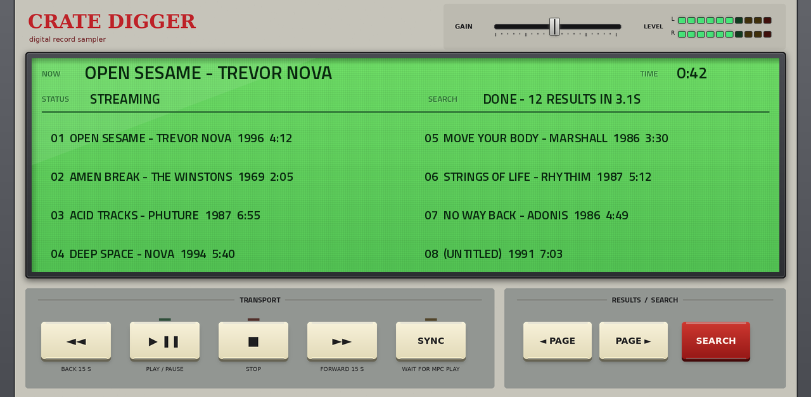
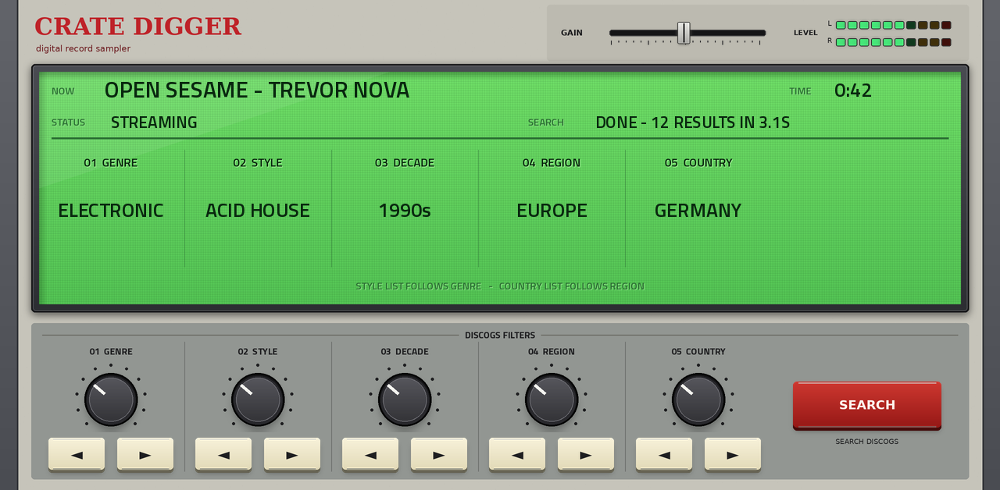
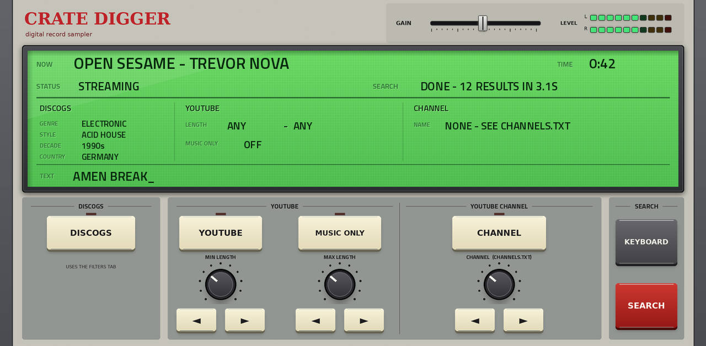

# Crate Digger for MPC

💬 Questions or feedback? Join the [Open MPC Discord](https://discord.gg/sRRysZSgu3).

**Crate Digger** is a plugin instrument for Akai MPC standalone devices that digs for records and plays them into an MPC track. Pick a genre,
style, decade, region and country, and it finds random releases on Discogs, then streams a playable version (usually from YouTube) so you can
audition and resample them. It can also search YouTube for text you type, or pick uploads from your own YouTube channels and playlists.

The screen is styled after a vintage MPC: a green LCD that shows what is playing, the status, the time and your filters, big knobs and keys,
a GAIN fader and a stereo level meter. Everything is reachable from the Q-Links.



## Features
- **Three pages.** PLAY (transport and the results), FILTERS (five knobs: genre, style, decade, region, country, each over its own column on the LCD) and FIND
  (source, text search, YouTube length filters, channels, popup keyboard).
- **Results:** up to 16 per search in a paged 2 x 4 list; tap a row to play it. A result that cannot play says why in STATUS (private video, removed,
  copyright, region blocked, ...); tap another row.
- **Transport:** play / pause, stop, 15 s back and forward, and a **SYNC** key for resampling: with it on a tapped result loads and waits, silent,
  until you press Play on the MPC; the MPC's Stop pauses it.
- **Sources (FIND):** DISCOGS (the filters, plus optional text), YOUTUBE (search for the text; set a minimum and maximum length; MUSIC ONLY), and
  CHANNEL (random uploads from a channel or playlist you list in `channels.txt`).
- **GAIN and LEVEL:** a horizontal gain fader and a stereo level meter on every page.
- **Saved with your project:** the filters, source, lengths, gain and the typed text come back when you reopen it. Projects saved with Crate Digger
  1.x still load.



## Requirements
- An MPC standalone device with a network connection (search and streaming happen on the device).
  - **64-bit MPCs (MPC Live III and other aarch64 units):** use the `aarch64` package.
  - **32-bit MPCs (Force, MPC Live, Live II, One, X, Key):** use the `armv7` package.
- Plugin folders are copied to the device; on a Force and other MPC OS that lists plugins in `MPC.settings` the installer needs **root shell access
  (SSH)**, which stock MPC OS does not offer. Installing plugins this way is unofficial: back up first and use it at your own risk.

## Install
Download the package for your device from [Releases](https://github.com/sd88me/mpc-vst-cratedigger/releases) and unzip it. Each package has an
`INSTALL.txt` with the same steps.

**MPC OS that loads plugin folders from `VST2 Plugins`** (aarch64 package, and the armv7 package on devices whose MPC OS supports it): copy the folder
`VST2 Plugins/sd88me - VST - Crate Digger` into a folder named exactly `VST2 Plugins` at the root of a drive the MPC can see (internal storage, an SD
card or a USB drive). Turn on **Preferences > Enhancements > Enable Enhancements** and **VST2 Support**, restart the MPC, and add **Crate Digger** from
External VST Plugins.

**Force and other MPC OS that lists plugins in `MPC.settings`** (armv7 package):
```sh
scp -r <the unzipped folder> root@<device-ip>:/tmp/crate-digger
ssh root@<device-ip> sh /tmp/crate-digger/install-force.sh
```
This stops the MPC (save your project first), copies the plugin to `/sdcard/Synths`, backs up and edits `MPC.settings`, and restarts the MPC. An
older Crate Digger (1.x) is replaced and your `channels.txt` is kept. Add `-y` to skip the confirmation.

The plugin folder is about 125 MB (armv7) or 180 MB (aarch64): it carries its own yt-dlp, Python and ffmpeg and needs no other setup. To upgrade,
replace the whole plugin folder.


## Using it
1. **FILTERS:** turn a knob (or tap its arrows) to pick a genre, style, decade, region and country; each choice shows on the LCD above its knob.
   STYLE follows GENRE and COUNTRY follows REGION. Press **SEARCH**.
2. **PLAY:** results appear as rows on the LCD. Tap a row to play it. Use PAGE to see the next eight.
3. **FIND:** choose a source. For text, press **KEYBOARD**, type, and press SEARCH on the keyboard (HIDE closes it without searching).

### Channels
List your channels in `channels.txt` in the plugin folder (next to `plugin.json`), one per line: a channel link, an `@handle`, a `UC...` ID or a
playlist link, and optionally a name after a `|`. See `channels.example.txt`. The CHANNEL selector steps through them. A channel's newest 500
uploads load in the background on the first search (it may say "Still loading the channel": press SEARCH again).

### Discogs token (optional, recommended)
Crate Digger works without a token (Discogs allows 25 requests a minute per device). A free personal access token from
[discogs.com/settings/developers](https://www.discogs.com/settings/developers) raises that to 60. Put it in
`/data/UserData/schwung/config/webstream_providers.json` on the device:
```json
{ "providers": { "cratedig": { "token": "YOUR_DISCOGS_PERSONAL_TOKEN" } } }
```

## Troubleshooting
The SEARCH and STATUS lines say what went wrong. See [docs/TROUBLESHOOTING.md](docs/TROUBLESHOOTING.md). The plugin writes
`/tmp/cratedigger_vst.log` on the device.

## How it works
The engine is the [schwung-webstream](https://github.com/charlesvestal/schwung-webstream) core (Charles Vestal, MIT), built here without `fork()`.
It resolves and streams Discogs results through yt-dlp and ffmpeg on a worker thread into a ring buffer; the MPC's audio thread only copies from the
ring. `src/sdk/CrateDiggerPlugin.cpp` is the plugin and `tools/make_tui.py` draws the skin.

## Build
Needs Docker. `./build-sdk.sh` builds both CPUs into `build/sdk/`; `tools/package.sh` makes the two zips in `dist/`;
`tests/run.sh` runs the offline test. The engine bundles (yt-dlp, Python, ffmpeg) are taken from the previous release the first time.

## Known limitations
- A browser and player, not a synth: it makes no MIDI notes and ignores MIDI input.
- Playback depends on yt-dlp resolving the linked sources live on the device; those paths break upstream from time to time, and a result can be
  unavailable in your region.
- Tested on an MPC Live III and a Force.

## Credits and licence
MIT, see `LICENSE`. The streaming core is MIT licensed by Charles Vestal (`UPSTREAM_LICENSE.txt`, `UPSTREAM_THIRD_PARTY_NOTICES.md`). The channel
source was started by PotentialBreakfast (PR #21).
